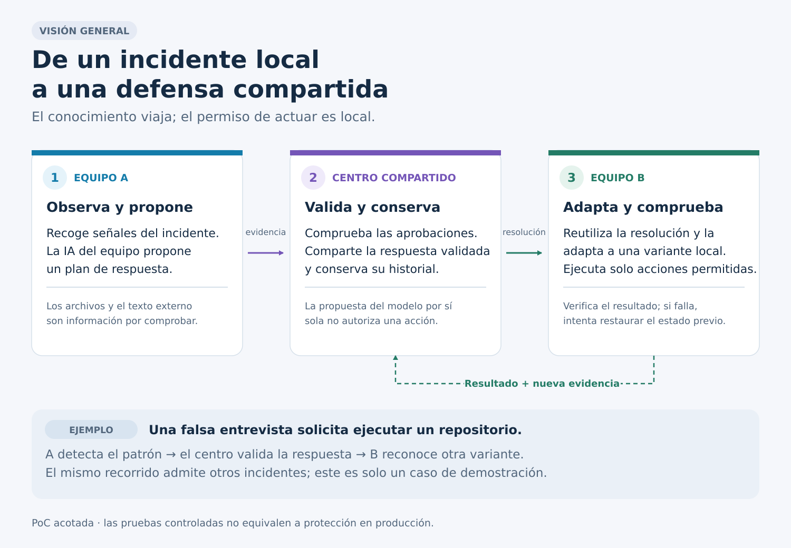

# Diagramas del recorrido de incidentes

Tres vistas complementarias en español. La primera explica el propósito sin exigir conocimientos técnicos. Las otras dos explican los límites de confianza y los contratos del recorrido de incidentes.

## Lectura rápida



- [Vista general, PNG](01_incident_learning_overview_es.png)
- [Componentes y límites de confianza, SVG](02_incident_components_es.svg) · [PNG](02_incident_components_es.png) · [Mermaid](02_incident_components_es.mmd)
- [Secuencia, SVG](03_incident_sequence_es.svg) · [PNG](03_incident_sequence_es.png) · [Mermaid](03_incident_sequence_es.mmd)

## Qué muestran

1. Un equipo recoge evidencia local de un incidente. El operador prepara un catálogo de acciones y un paquete borrador; el modelo propone qué acciones existentes encajan con la evidencia.
2. El conocimiento compartido se admite solo tras verificar el contrato, las firmas y la política de aprobación.
3. Otro equipo recupera una versión válida y adapta su aplicación al caso local, sin crear acciones nuevas.
4. Un permiso local independiente del modelo habilita acciones tipadas. El ejecutor comprueba el estado antes y después; si falla tras modificarlo, intenta restaurarlo y registra el resultado.
5. El resultado vuelve como evidencia. Esto no equivale a aprobar automáticamente una nueva versión.

La falsa entrevista es un ejemplo de entrada. No define por sí sola el dominio completo de la plataforma. El flujo ilustrado es una prueba de concepto acotada, no una afirmación de protección general ni una prueba de operación distribuida en producción. La ejecución con un doble de modelo no acredita inferencia LLM real.

## Correspondencia con el código

Los diagramas describen el recorrido de incidentes de estos archivos:

- [`IncidentCollector`](../../src/avchain/incident/collector.py): lectura de una raíz acotada, identificadores hash, límites y hechos observados. No ejecuta el contenido recogido.
- [`IncidentTriage`, `LocalIncidentModel` y `validate_triage`](../../src/avchain/incident/triage.py): texto externo sin autoridad, salida tipada y vínculos a acciones existentes respaldados por evidencia. Los modos `rules`, `test_double` y `local_llm` quedan identificados en el resultado. Las flechas LLM representan el backend opcional, no una afirmación de que se haya ejecutado en una prueba concreta.
- [`RemediationPackage`, `ValidatorApproval`, `SignedPackage` y `ExecutionReceipt`](../../src/avchain/incident/models.py): contratos del paquete, firmas y resultado. La validación del esquema impide añadir campos de comandos libres.
- [`KnowledgeStore`](../../src/avchain/incident/knowledge.py): publicación condicionada a entrada `confirmed`, evidencia vinculada, firmas Ed25519 de una mayoría de claves independientes, vigencia y avance de versión. La revocación también requiere firmas. Al recuperar se comprueban estado, vigencia, integridad y revocación.
- [`knowledge_router`](../../src/avchain/incident/api.py): rutas autenticadas bajo `/ledger/remediation`, sobre los servicios y persistencia existentes; no es otra plataforma paralela.
- [`KnowledgeClient` e `IncidentNode`](../../src/avchain/incident/node.py): obtención del paquete, checkpoint de la mayor versión observada e investigación de otra variante. Antes de ejecutar vuelven a consultar el centro; si cambió el paquete, exigen investigar y aprobar de nuevo.
- [`LocalApproval` y `ScopedExecutor`](../../src/avchain/incident/executor.py): permiso creado fuera del modelo y ligado a incidente, digest del paquete, bindings, raíz y caducidad. Verifican los hashes de archivos y solo aplican `disable_npm_hook` o `quarantine_file`, con journal local, postchecks y restauración comprobada.
- [`run_incident_demo`](../../src/avchain/scripts/run_incident_demo.py) y [`lab.py`](../../src/avchain/incident/lab.py): composición de A, validadores, centro y B; paquete borrador preparado por el catálogo; feedback por las API existentes. A y B son roles de un laboratorio local, no dos instalaciones remotas acreditadas. El replay ejecuta únicamente fixtures propios con token artificial y destino loopback. Sus firmas y votos de laboratorio son deterministas, no evaluaciones independientes realizadas por LLM.

La separación importante es entre propuesta, aprobación central y permiso de ejecución local. No se presenta `LocalApproval` como autenticación de usuario de producción. El ejecutor presupone una raíz de laboratorio sin modificaciones concurrentes; no constituye un sandbox del sistema operativo. Si la restauración detecta cambios ajenos, puede devolver `rollback_incomplete`. Las firmas tampoco acreditan por sí solas que un transporte o servidor no esté ocultando una versión más reciente.

El feedback y los recibos se guardan como evidencia; no conceden aprobación a una nueva versión.

## Regeneración sin red

Requiere Python 3.12+, Inkscape y la fuente DejaVu Sans. No requiere servicios externos ni claves.

```bash
python docs/diagrams/render_diagrams.py
python docs/diagrams/verify_diagrams.py
```

Para generar solo SVG, sin Inkscape:

```bash
python docs/diagrams/render_diagrams.py --svg-only
```

`render_diagrams.py` es la fuente de maquetación de las tres imágenes. Los archivos Mermaid son fuentes semánticas de los diagramas técnicos: se pueden abrir en un visor Mermaid, pero no producen exactamente esta maquetación. Si cambia un contrato, actualizar ambos antes de regenerar. Los SVG contienen título y descripción accesibles, no scripts ni dependencias remotas.

El SVG conserva texto escalable. El PNG es una alternativa para visores sin SVG. Ninguna imagen contiene datos personales del usuario ni información de un incidente real.

## Inclusión mínima en el README principal

```markdown
## Cómo aprenden los nodos de un incidente


[Componentes, secuencia y límites de la demostración](docs/diagrams/README.md)
```
